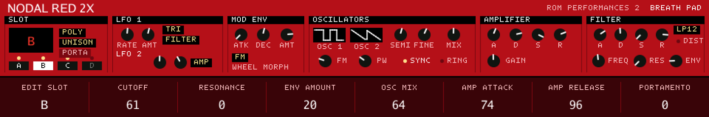

# Pung-native modules

Status: 2026-11-18. The first one, Nodal Red 2X, runs as a device in Live on a Push 3 with the firmware:
notes, SOUNDS with its banks and names, its own screens, the firmware's own sounds, and its state across
a restart of Pung. It is not in the published catalog yet.

## Two kinds of module

| | Schwung-derived | Pung-native |
|---|---|---|
| Source | the module's own repository, listed in Schwung's `module-catalog.json` | `native/<id>/` in this repository, listed in `native/catalog.json` |
| Built for | Move (ARM) by its author, and for the Push by Pung | the Push only (x86-64) |
| Build | a recipe read from the module's build script, never run (`docs/push-module-builds.md`) | its own CMake and a hand recipe, `scripts/recipes/<id>.sh` |
| Limits | Move's processor, Move's 128x64 screen, Move's `ui.js` | the Push's: four cores, its screen, its eight encoders |
| Updates | follow the author's releases; what Pung adds sits in layers on top | released with Pung's catalog |

A module is native when it would not run on a Move, or has no reason to be shaped by one. Nodal Red 2X
emulates two DSPs and a 68k at 98.2 kHz, which a Move cannot do.

## What stays the same

A native module is loaded by the same chain host through the same plugin API (`plugin_api_v2`,
`move_plugin_init_v2`), and answers the same keys: `chain_params`, `ui_hierarchy`, `state`, `preset`,
`preset_count`, `preset_name`, `is_loading`, `loading_status`, `load_error`. So SOUNDS, the web page, Live's
parameters, a Set's saved state, the catalog and the module manager work with it unchanged. What Pung
adds for a module (`push_ui.js`, the file browser, sound names) is used the same way.

It is not a new plugin format. Only where the source lives and what it may assume are different.

## Rules for a native module

1. **Render off the audio thread when a block can take long.** `render_block` runs on the device's
   audio thread with 1.45 ms to answer. An emulator renders on its own thread into a ring, and
   `render_block` only reads the ring (Nodal Red: 7 ms ahead).
2. **Set the priority of your own threads.** Below the host's audio threads (FIFO 70) and the engine
   (60), above ordinary work. Nodal Red: FIFO 45, set on the thread that creates the emulator's threads,
   so they inherit it.
3. **Keep `dsp.so` unloadable:** `-fno-gnu-unique`, `-Wl,--exclude-libs,ALL`, static libstdc++.
4. **No firmware in the package.** ROMs are the user's; `module.json` `assets` says which files.
5. **Ship every licence text** of what is linked in, in `licenses/`.
6. **The parameter list is fixed once released.** Live keeps a device by its class, and the class is
   made from `chain_params`. Taking a parameter out (Nodal Red's bank knob, before its release) made the
   device vanish from the open Set at Live's next start.
7. **Sounds by the contract:** a bank chooser is a level with `items_param` and `select_param`, and the
   list answers `preset_names` (every name of the bank) and `preset_name_<n>`. Then SOUNDS shows banks and
   names without loading a sound. A bank as a plain knob gives a list of one bank.

## Layout

```
native/catalog.json          the native modules: Schwung's entry shape, plus native, modsrc, deps
native/<id>/module.json
native/<id>/CMakeLists.txt
native/<id>/dsp/...
scripts/recipes/<id>.sh      the recipe (required)
scripts/sync-native.sh       native/<id> -> build/modsrc/<modsrc>, its deps beside it; build/catalog-merged.json
```

`deps` names source trees the module is built with, each pinned to a commit. They are synced into the
module's folder under `build/modsrc`, so the module is built, and its source archived for the catalog, from
one folder like every other module. Nodal Red's one dep is gearmulator (`rgeissen/gearmulator`, the fork
JE-8086 is built from).

```bash
scripts/build-push-modules.sh nodalred                       # build and package
python3 scripts/build-catalog.py --base-url "" nodalred      # into the catalog (build/catalog)
```

## Nodal Red 2X

`native/nodalred/dsp/nodalred_plugin.cpp`, on gearmulator's `n2xLib`.

- **Threads:** one emulator thread renders 64 frames at a time through `synthLib::Plugin` (which resamples
  98.2 kHz to 44.1 kHz) into a ring. The emulator's two DSP threads and its 68k thread inherit FIFO 45.
- **The sound is kept in the module** as the synth's own dumps, one multi and four singles. Every change
  goes through the module, so nothing is read back from the emulator. `state` is the multi dump.
- **Slots:** `slot` picks the slot the parameters edit, `slot_a`..`slot_d` put slots into the layer. Slots
  that are on listen on MIDI channel 1, the others on none. A controller for one slot goes past the
  emulator's channel translation (`createPacketSkipTranslation`).
- **Parameters:** 83, of which 75 belong to the synth and 8 to the module (sound, bank, slots, gain). 42
  have a MIDI controller and are sent as one. The filter type and the 25 morph ranges exist only in a
  dump: the slot's single dump is sent, at most one every 120 ms. The 7 performance parameters send the
  multi dump.
- **Sounds:** the emulated synth has none of its own. `banks/*.syx` are read at start; each file is a
  bank, each program or performance dump in it a sound. A program loads into the edited slot, a
  performance replaces all four. The Nord stores no names: `<file>.txt` beside a bank names its sounds,
  one a line. Percussion kits (1063-byte dumps) are skipped.
- **Clavia's factory library** (4 program banks, 100 performances, as `.syx`) was played through on the
  Push, two notes per sound: 494 of 496 sound, the other two want the mod wheel. A sound change costs one
  or two short underruns. Program banks 4 to 9 and performance banks 1 to 3 are in the firmware itself
  and cannot be reached yet.
- **Incoming controllers** other than the wheel, the pedals and all-notes-off are dropped: every other
  controller is a knob of the synth and would change the sound behind the parameters.

- **A controller right after a dump is lost** (measured): the synth is still receiving the dump, at MIDI
  speed, and the dump's value wins. So while a dump is on its way, or waiting, a change goes out in the
  next dump instead of as a controller, and dumps are sent one at a time.
- **The emulator's logs are switched off:** the 68k core writes every register access to stderr.

### Measured on a Push 3 (i3-1115G4, 2 cores, 4 threads), 2026-11-18

In a harness that calls `render_block` every 2.9 ms, beside a running Live:

| | |
|---|---|
| Boot | 1.8 s |
| DSP A, DSP B threads | 50 to 58 % of a logical core each, whether 0 or 20 voices sound |
| Emulator thread | about 11 % |
| A 64-frame block (1.45 ms of audio) | 0.78 to 1.06 ms, at most 1.51 ms |
| Underruns, 20 voices in 4 slots | 0 |
| C4 | 261.5 Hz |

The emulator runs about 1.5 times as fast as it must. The DSP clock setting gearmulator offers changed
nothing here (tried 30 to 100 %), so it is not a parameter.

Checked by spectrum: the four waveforms of each oscillator, the mix, filter types 1 to 4 (LP 12, LP 24,
HP 24, BP), cutoff, a program and a performance loaded from a bank file, state save and restore. Filter
type 5 looks like notch plus low pass; type 6 can only be set by a dump and is not on the real panel.

### The shutdown crash

On the Push the module crashed in `~JitBlockChain` on 6 of 8 shutdowns. gearmulator's `MmuArray` unmapped
a block and mapped it again; another thread's `mmap` could take the address in between. The Nord has two
DSP threads. `native/nodalred/patches/0001-mmu-remap-atomically.patch` replaces the mapping in one step:
18 of 18 shutdowns clean. The patch is applied by the recipe and has not been sent upstream.

### In Live on the Push, 2026-11-18

Loaded on a MIDI track through the Remote Script. Notes sound (-14 dB for a four-note chord), the audio
thread's part takes 0.06 to 0.6 ms a block, no late blocks while playing. SOUNDS lists six banks and a
bank's 99 names; a sound auditioned and cancelled comes back. The seven parameter pages draw with Pung's
standard pictures (filter curve, envelopes). An edit and the chosen sound survive a restart of Pung.

### Its screens (`native/nodalred/push_ui.js`)




The Nord has no menus, its panel is the instrument, so the compartments are the panel's sections, each
with a picture of what its knobs do together:

| Compartment | The picture |
|---|---|
| Panel | the whole Push screen as the instrument's front panel, in its red: every knob where the hardware has it, standing where the sound has it; the slot display and buttons, the selectors as lit legends. A front panel; the encoders play slot, cutoff, resonance, envelope amount, mix, attack, release, portamento |
| Slots | the four slots as tiles over their on/off knobs: the sound, the waves, the filter, which are layered, which one the knobs edit |
| Oscillators | both waveforms as they are (pulse width, the interval, hard sync, FM), and their mix or ring modulation |
| Filter | the response of the chosen type, where the envelope takes the cutoff, the envelope |
| Amplifier | the envelope, and how keys are played, in words |
| Modulation | who moves what: LFO 1, LFO 2 or the arpeggiator, the mod envelope and the wheel on the left, their destinations on the right, a line as strong as the amount |
| Morph | every morph range on its own knob: the line is where the knob stands, the arc where velocity or the wheel takes it |

Every other screen carries the red as a bar at its left edge. The name on the panel is the emulator's
(Nodal Red 2X), never Clavia's.

Three things it needed:

- **`slots_info`**: one read that says all four slots (the parameters only say the edited one).
- **A selector** (`"selector": true` on `slot` in `chain_params`): turning it from Live changes what the
  other parameters read, so Pung reads them back within 60 ms (`devices.go`, `wantResync`).
- **Cached curves.** The first version took 9 ms a frame on the Push, whose processor the emulator is
  already using, and Pung switched it off (the limit is 8 ms). Every curve is now computed when what it
  shows changes: 2 to 5 ms a frame.

### One emulator at a time

2026-11-18: after a restart of Live, its recovery brought back a Set with two Nodal Red devices. Two
emulators are six threads at realtime priority wanting three cores; the Push has two. It stood still
for seven minutes, until it was switched off and on.

The module now takes a system lock (`flock` on `/dev/shm/pung-nodalred.lock`) before it starts the
emulator. An instance that finds it taken stays silent, says "Waiting: another Nodal Red 2X is running",
and starts when the other is gone. The lock also holds between Pung and the child processes that probe a
module. Checked on the Push with two instances at once: one set of emulator threads, the second started
the moment the first closed.

Rule 8 for a native module: **what cannot run twice must refuse to run twice by itself.** A Set, Live's
recovery or a duplicated track can always ask for a second one.

### A knob and the screen

Reported 2026-11-18: a turn showed on the screen with a long lag. Measured on the Push, from the turn
to the frame sent (`/api/surface/state`, `turn_to_screen_ms`): 60 to 110 ms. A CPU profile of Pung
(`/api/debug/profile`) named three causes, none of them the emulator:

| Cause | Fix | Share |
|---|---|---|
| Pung read and parsed every module's `module.json` many times a frame (`findModule`) | the list is kept while the module folders are unchanged (`scanModules`) | over half of Pung's own processor time |
| the panel drew its ground, frames and legends every frame, in JavaScript | `g.layer`: drawn once, copied after that | 26 ms a frame down to 3 |
| a frame waited for a 33 ms clock, and filling rectangles blended pixel by pixel | a 16 ms clock; solid fills written straight into the pixels | 25 ms and 5 ms |

After: 8 to 16 ms on the panel, 13 to 23 ms on the filter page. The first cause slowed every module's
view, and grew with every module installed.

### The firmware's own sounds

Program banks 4 to 9 and performance banks 1 to 3 are part of the firmware. The synth sends any of them
when asked (a dump request), so on its first start the module asks for all 890, one at a time, and writes
them into `banks/` as `ROM Programs 4.syx` and so on. In Live on the Push that took 200 seconds, with
dropouts while it ran; it happens once. A request's type is the dump's plus 14 (a program) or plus 10 (a
performance); type 20 also means "send all controllers" for slots 0 to 3, so the first four programs of
bank 5 cannot be asked for.

### Every option name, measured

The manual lists a selector's options top to bottom and the synth counts them from the bottom. Each was
checked on the Push by spectrum or pitch track: the oscillator waves, the filter types and key tracking,
the LFO 1 waves (Random, Saw, Triangle, Square, Soft Random) and destinations (PW, Filter, Osc 2, Osc 1+2,
FM), LFO 2 and the arpeggiator in one parameter (Arp Down, Arp Up, Arp Up/Down, LFO Amp, LFO Osc 1+2, Arp
Random, Echo, LFO Filter, Off), the mod envelope's destinations (Osc 2, FM, PW, None), the voice modes
(Mono, Legato, Poly). LFO 2's mode only settles when it arrives in a dump, not as a controller after an
arpeggiator mode.

### Not verified yet

- A Set saved in Live and opened again.
- The pressure and pedal destinations' names (taken from gearmulator's list).
- Turning Edit Slot on a Push encoder (the selector's read-back), by hand.
- Four slots layered at full level clip; whether the default output gain should be lower.

## Options that cannot be chosen now

A list parameter may name a key that says which of its options can be chosen at the moment:
`"available_param": "slot_available"` in its `chain_params` entry, and the module answers that key with
one character an option (`"1010"`). A turn on the Push passes over the others, so the value never shows
one of them, and the web page greys their buttons. Nodal Red 2X uses it for the edit slot: only the slots
that are on.

## OsTIrus (Access Virus TI)

gearmulator's Virus TI (`virusLib`), measured on a Push before it was built: the TI and TI2 at 2.3x real
time under load (about 77% of one core at real time), the Snow at 3.1x (about 40%). Nodal Red 2X's
foundations: the emulator on its own threads feeding a ring, 6 dB of headroom and a soft limiter, one
instance at a time (`/dev/shm/pung-ostirus.lock`).

- **One firmware, three synths.** The installer's `.bin` holds the TI, the TI2 and the Snow; `model`
  starts the emulator again as the other. Its factory banks are the banks, their names read from it.
- **A parameter is a byte of the single.** The 512-byte single (pages A, B, 6E, 6F) is the state; a
  turned knob changes its byte and sends that byte as a parameter change, so the dump is always the
  sound as it is.
- **The layout is generated, the design is not.** `tools/gen_params.py` reads gearmulator's own
  descriptions (`parameterDescriptions_TI.json`: pages, ranges, value texts) and lays them out by the
  table at its top: one page one thought, eight knobs, the same knob doing the same job on sibling pages
  (Attack knob 1 of every envelope, Rate knob 1 of every LFO). 234 parameters on 32 pages: of a single's
  563 bytes, about 300 are not for a player (arpeggiator steps, name characters, controllers).
  Names are twelve characters at most, so the encoder row shows them whole.
- **Numbers name their values.** A long value list (a send level in dB, 124 matrix destinations) is a
  number that shows its text (`value_labels` by reference into `value_lists`): an enum steps one
  option a gesture, and inline lists would not fit chain_params.
- **The front panel is the Soft Knobs.** Every TI patch points three knobs at what matters in it and
  names them; the device opens on a front panel whose first three encoders are those knobs under the
  patch's names, beside cutoff, resonance, filter envelope and the two sends. Above them the display
  and what the patch is made of: oscillator models, filter modes and routing, the effects that are on.
- **Not yet:** the TI's multi mode (16 parts), the vocoder and input (an instrument has no input).

## Vavra (Waldorf microQ)

gearmulator's microQ (`mqLib`): a 68000 running Waldorf's OS beside one DSP56300, about 22% of one core
on a Push. Its engine is `waldorf_engine.cpp`, shared with Xenia (the Microwave II/XT, `xtLib`, which
waits for a ROM dump): OsTIrus's design, the emulator on its own thread into a ring, one instance at a
time (`/dev/shm/pung-vavra.lock`), the firmware found by gearmulator's own loader in `roms/`.

- **The OS carries no sounds.** A microQ keeps them in flash, so they come from sound sets: Waldorf's
  sysex dumps in `sounds/` (the factory set `mQ_factory2001.mid`, 300 sounds), read with gearmulator's
  MIDI file reader. A sound loads as a dump into the edit buffer, with the ring deep (as OsTIrus).
- **A parameter is bits of a byte.** 341 of them (`tools/gen_params.py` writes `dsp/mq_params.h` and the
  page lists in `push_ui.js`); a turned knob sends the whole byte, so a parameter sharing it (voice mode
  and unison, an envelope's mode and trigger, an arp step's type, glide and accent) is kept.
- **The effects reuse their bytes.** What byte 130 means depends on the effect in the slot, so the
  effect knobs are neutral (`fx1_p1`..) and a table per effect type says what each is. In Live they are
  "FX1 Param N"; the effects panel names them (`fx1_labels`, `fx1_values`).
- **The front panel is the edit matrix**, seven rows of eight, the lower buttons lighting a row
  (`draws_tabs`). Live keeps those rows, the oscillators and the mixer: Live pads every page to eight,
  so a short page costs slots.
- **Warmed up before it is heard**, as OsTIrus: the first chords after a start underran the ring while
  the emulator compiled (seven in a minute, a block of 22 ms), none after.
- **Heard without Live**: `scripts/render-check.sh vavra <assets>` loads the shipping `dsp.so` as the
  chain host does and measures a chord. Measured 2026-11-20: every bank plays, the pitches are right
  (C3 at 130.5 Hz), closing Filter 1 moves the chord from -26 to -49 dB.
- **In Live, 2026-11-20**: 128 parameters; a parameter set from Live reaches the synth; beside OsTIrus
  and Braids, all three playing, the Push 53% idle and no dropout of Vavra's own; a sound and its edits
  survive a restart of Pung.

