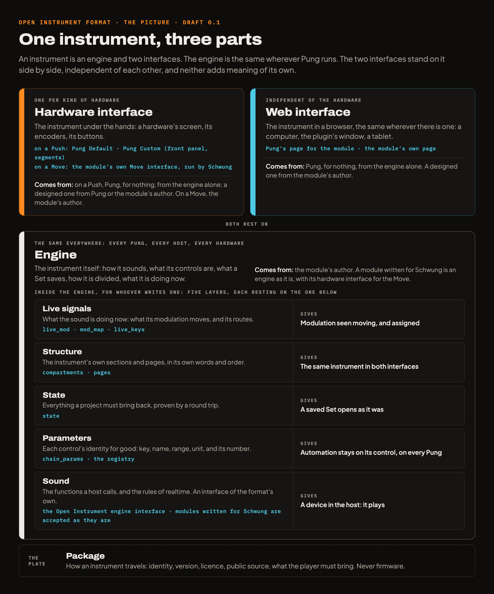

# The Open Instrument format

**Draft 0.1** (2026-11-28). A first writing-down of how an instrument for Pung is built. Most of it describes
what exists; what does not exist yet says so, in "What holds today" at the end. It is a draft: nothing here is
promised until it carries a version without "draft".

## Two words

- **The format** is what an instrument is: its parts, what each one holds, and what each one may rely on.
- **The standard** is this document: the format's rules, with a version, and the way a module is described
  against them.

An instrument here is a module: one instrument, audio effect or MIDI generator. Pung is the platform that
hosts instruments in this format; it is not the format.

## One instrument, three parts

| Part | What it is | How many |
|---|---|---|
| **Engine** | The instrument itself: how it sounds, what its controls are, what a project saves, how it is divided, what it is doing now | One, the same on every Pung, in every host, on every hardware |
| **Hardware interface** | The instrument under the hands: a hardware's screen, its encoders, its buttons | One per kind of hardware |
| **Web interface** | The instrument in a browser: on a computer, in a plugin's window, on a tablet | One, independent of the hardware |

Three rules hold the parts together.

1. **The engine knows nothing of an interface.** It can be played, saved and automated with no interface
   at all.
2. **The two interfaces are independent of each other.** Neither is a version of the other; a web page
   need not follow a hardware's layout, and a hardware's panel need not mirror the web page.
3. **An interface adds no meaning.** It reaches the instrument only through what the engine says of itself.
   A name, a section, a control or a range that exists in an interface and not in the engine is a fault.

Every part can be supplied by default. A platform builds a hardware interface and a web interface from the
engine alone, so an engine that runs is already a whole instrument. A designed interface replaces the
default where someone has made a better one.

## The engine: five layers

Each layer rests on the one below. An engine may stop at any layer and still plays.

### 1. Sound

The functions a host calls, and the rules of realtime.

- An instrument's functions: make an instance, destroy it, take MIDI, set a parameter, answer a parameter,
  answer an error, render a block. An audio effect and a MIDI generator have their own entry points with
  the same shape.
- Every instance is independent of every other.
- Rendering is realtime: no allocation, no file, no lock another thread may hold for long, no logging.
- A host may make every call into an instance wait on the block being rendered, so no call may be slow.
  What must be read from a disk is read on a thread of the engine's own and handed over.

Version 0.1 of this interface is, function for function, the plugin interface of Schwung (`plugin_api_v1.h`,
by Charles Vestal, MIT): 16-bit stereo at 44.1 kHz in blocks of 128 frames, parameters as text. That is why
a module written for Schwung is an engine as it is. A later version may add to it; it will go on accepting
those modules.

### 2. Parameters

Each control's identity, for good.

- A parameter has a **key**, a name, a type, a range, a unit where it has one, and for a choice its options
  by name.
- **A key never changes its name or its meaning.** Projects, automation and saved sounds name it.
- **One key for one control.** Two keys for the same thing fight when a state is restored.
- A parameter has a **number** that is the same on every installation, in every host
  (`docs/SET-CONTRACT.md`): what a host stores against a control still points at it elsewhere.
- New parameters are added at the end. One that is gone leaves its place empty.

### 3. State

Everything a project must bring back.

- An engine answers its state and takes it back. What is not in the state is lost when a project is opened
  again.
- **The round trip is the test**: set values, take the state, give it to a fresh instance, ask the values.
  Every one comes back.
- A state means the same on another installation: it names nothing by its place in one machine's lists.
- A sound is a state with a name (`docs/PRESETS.md`).

### 4. Structure

The instrument's own sections and pages, in its own words and order.

- **Compartments** are the instrument's sections (oscillators, filter, envelopes): each has an identity, a
  name, a place in the order and the controls that belong to it. **Pages** divide a compartment.
- Structure is meaning, not layout: it is the same in every interface. How a compartment is shown is the
  interface's (`docs/UX-GUIDELINES.md`, section 1).
- Every parameter belongs somewhere. Early pages hold what is played most.

### 5. Live signals

What the sound is doing now.

- Which controls the engine's own modulation moves, and where the sound has each at this moment
  (`live_mod`).
- Its modulation routes: sources, destinations, amounts, and a way to set one (`mod_map`, `mod_set`).
- Values of its own that an interface may show moving (a voice's level, an LFO's phase: `live_keys`).
- These are asked many times a second: their answers are cheap and wait on nothing.

## The hardware interface

One per kind of hardware. It is made for that hardware's screen and controls and for nothing else.

- **Default**: built by the platform from layers 2 to 5. On a Push this is *Pung Default*: pages of eight,
  real names and units, live pictures of the envelopes, filters and LFOs it recognizes.
- **Designed**: made for one instrument on one kind of hardware. On a Push this is *Pung Custom*, a
  `push_ui.js` (`docs/overrides.md`): from the instrument's own colours on the default pages up to a front
  panel.
- What groups controls so that hands reach them (a Push panel's **segments**, eight controls at a place on
  its screen) belongs to that hardware. Nothing that must hold everywhere may name it.
- A designed interface ships only where it shows what the default cannot (`docs/UX-GUIDELINES.md`,
  section 5).

Ableton Move is a kind of hardware too. What a module written for Schwung carries for it (its Move screen
and knob layout, which Schwung runs) is that instrument's hardware interface for the Move.

## The web interface

One, independent of the hardware: the same wherever there is a browser.

- **Default**: the platform's own page for the instrument, built from layers 2 to 5.
- **Designed**: a page of the instrument's own.

Four rules make a designed web interface something that can be handed on to anyone who hosts the same
engine:

1. It reaches the engine only through one remote interface that any host can serve: read and set a
   parameter, read the state, the structure and the live signals.
2. It lives with the module, or in an open repository.
3. It carries a licence the module's author can accept.
4. What one platform adds (Pung's stream of live pictures, for one) is optional: the page works without it.

## The package

How an instrument travels. It is the plate, not a layer.

- An identity that never changes, a name, a version that changes whenever the package does.
- A licence that allows shipping, as a text in the package, and the source it was built from, public at a
  commit.
- What the player must bring (samples, sounds of their own), named, with the place it goes.
- **Never firmware, ROMs or factory sounds that are not the author's to give.** An emulator names what the
  player must bring.

## Describing a module

Three parts are present in every instrument a platform hosts, so "complete" says nothing. A module is
described by how far it goes:

- **the engine, to a layer**: 1 to 5;
- **the hardware interface**, for each kind of hardware: default or designed;
- **the web interface**: default or designed.

> Engine to layer 5 · designed hardware interface for the Push · default web interface

## Modules written for Schwung

A module written for Schwung is an engine as it is (layers 1 to 3, and its pages of layer 4), with a hardware
interface for the Move, and sometimes a web page of its own. Pung plays it unchanged. The other way: an engine
that keeps to version 0.1 of the sound layer, built for a Move, runs there under Schwung, and a designed web interface
that keeps the four rules above runs there too. What this format adds above Schwung's (parameter numbers,
compartments, live signals, a hardware interface for a Push) a host that does not know it ignores.

## What holds today

| | Today |
|---|---|
| Sound | Holds. The interface is Schwung's, function for function. |
| Parameters | Keys hold. The numbers are built (`src/registry.json`) and not yet switched on: `docs/SET-CONTRACT.md`. |
| State | Holds for most modules; nothing checks the round trip for every module of the pack. A module's MIDI generator is still named by its place in one machine's list unless the Set contract is on. |
| Structure | Pages come from the engine. **Compartments are declared in the Push's screen file**, not in the engine: the format puts them in the engine, and moving them is not done. |
| Live signals | Many modules answer `live_mod`; fewer answer `mod_map`. |
| Hardware interface | A Push: default for every module, designed for some. A Move: the module's own, run by Schwung, not by Pung. |
| Web interface | A module's own page keeps rule 1 (it talks to the remote interface Schwung has, which Pung serves unchanged). **Pung's default page does not**: it talks to Pung's own interface. |
| Describing a module | No tool yet says how far a module goes. `scripts/dev-module.sh` and `scripts/render-check.sh` build one, play it and round-trip its state. |

## Open

- Whether sounds are part of the state layer, as written here, or a layer of their own.
- The part's name: "hardware interface" here; "device" is avoided because it is a host's word for what a
  module becomes on a track.
- A Push panel's lists of modulation destinations hang on its segments, which are the hardware's; what of
  them is meaning belongs in the engine.
- When the sound layer moves past 16 bits at 44.1 kHz, and how.
- A check that reads a module and states its description.
- Who changes this standard, and how a change is proposed.
